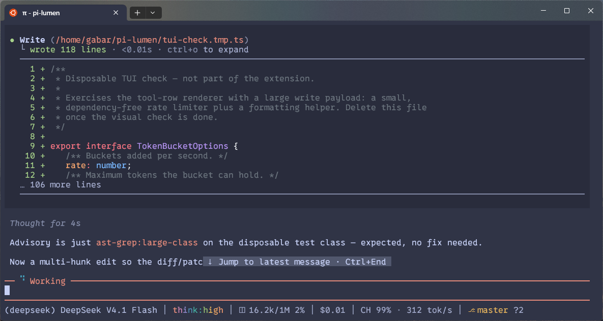
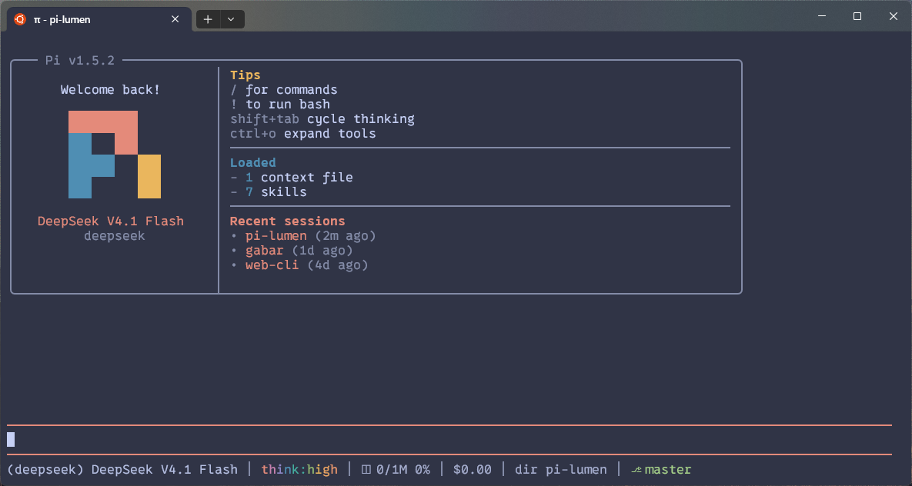

# pi-lumen

A small extension for [pi](https://pi.dev) (tested on pi 1.5.2): a powerline-style status line,
thinking-level colors, compact `read`/`bash`/`edit`/`write` rows and transcript timestamps.



## Install

```bash
pi install git:github.com/G4bar/pi-lumen   # or: pi install /path/to/pi-lumen
```

No configuration is required. Try it once with `pi -e ./src/index.ts`.

## Status line

One line, `above` or `below` the editor. The native footer is replaced by an empty component that only
captures the git branch and the statuses other extensions publish (pi-sync, pi-lens LSP, …). Those statuses
are **not** drawn in the line by default (it stays clean): read them with `/status`, or opt individual keys
back in with `inlineStatusKeys`.

| Segment | Content |
|---|---|
| model | `(provider) model name` |
| think | level, colored like pi's thinking border; `high`/`xhigh`/`max` use a gradient through the logo colors |
| context | `84k/200k 42%`, `?/200k` right after compaction; yellow > 70 %, red > 90 % |
| spend | API key → `$0.42`; subscription login → `5h 37% · 7d 12%` quota when available, otherwise reported cost or `sub` |
| cache · tps | `CH 81%` (hit rate of the latest request on the active branch; `CH --` after compaction/model change; hidden if the provider never reports cache) · `62 tok/s` |
| dir | basename of the working directory |
| git | branch, then `*unstaged +staged ?untracked` |
| ext | statuses of other extensions, only for the keys listed in `inlineStatusKeys` (none by default) |

If the line does not fit, segments are dropped in this order: ext → dir → cache/tps → spend → git counters → git
branch. model, think and context always stay, and so does the git branch with its counters as long as possible (the model
name is truncated last).

**TPS** is `output_tokens / seconds(first content → message end)`. While streaming it is estimated as
chars/4; at message end it uses the exact `usage.output`. It is *not* server speed, and it does not
match the `tok/s` of pi-stamp, which starts at message creation and therefore includes the wait.

### Commands

| Command | What it does |
|---|---|
| `/lumen` | Shows the current state as a notification: `pi-lumen on · placement below · quota on · tools on (box neutral) · stamp on · provider/model`. Changes nothing. |
| `/lumen placement above\|below` | Moves the status line above or below the input box. |
| `/lumen placement toggle` | Switches to the other position. |
| `/lumen box neutral\|theme\|none` | Tool-box background of the tool rows: `neutral` (default) grey, `theme` pi's own panels (green on success), `none` flat rows. Without an argument it shows the usage and the current value. It applies to the tool rows drawn from then on (rows already on screen keep theirs); `/reload` redraws them. |
| `/lumen on` / `/lumen off` | `off` hands the footer, working indicator and thinking label back to pi (the status line, thinking colors and indicators go away); `on` installs them again. It applies at once, no restart. |
| `/status` | Every status published by other extensions (`pi-sync`, `pi-lens · LSP`, unknown keys as-is), plus the loaded extensions with their command/tool counts. A snapshot shown as a notification; it needs the pi-lumen footer (with `/lumen off` pi's own footer shows the statuses). Richer details stay in each extension's own command (`/lens`, `/sync`). |

Each `/lumen` subcommand also prints the new state. A wrong argument shows the usage line and changes nothing.

Placement, box and on/off are saved to `~/.pi/agent/pi-lumen.json` (pi has no API to write `settings.json`), so they survive restarts.
They override the same keys in `settings.json`. Everything else (separator, icons, `tools.*`, quota, stamp, …) is configured in
`settings.json` only, see [Configuration](#configuration); there is no command for it.

**Colors.** Kept low on purpose. Only the model and its provider, `(anthropic) Sonnet 5.5`, are colored: plain ANSI white on dark themes, ANSI black on light ones (`theme.appearance`). It is the terminal's own palette white, softer than a truecolor `#ffffff`.
Context, spend/quota, `tok/s` and cache are plain (dim/muted) and only turn warning/error when it matters: context
above 70/90 %, quota from 75/90 %, cache hit rate below 70/30 %. The directory is plain and git keeps its theme
colors (green: clean, yellow: changes). The thinking level and the working spinner use the prompt box border color of the level
(the theme's `thinkingOff` … `thinkingMedium` tokens); from `high` up (`high`, `xhigh`, `max`) they use a smooth gradient through pi's logo colors (coral, blue, yellow): across the letters in the label, and drifting slowly over three braille turns in the spinner, so it does not flicker.

## Themes

The package ships two themes built on pi's logo colors, coral `#E48A7A`, blue `#4F8EB3` and yellow `#EAB65D`:

| Theme | Base | Mapping |
|---|---|---|
| `pi-dark` | Catppuccin Frappé backgrounds | `accent` coral, `border` blue, `mdHeading`/`warning`/`thinkingMedium` yellow |
| `pi-light` | Catppuccin Latte backgrounds | same hues, darkened until text keeps its contrast |

The thinking scale of the prompt box border (the `think:` label and spinner follow it up to `medium`, then turn into a logo-color gradient) goes from grey (`off`, `minimal`) through blue (`low`) and
yellow (`medium`) to coral (`high`) and two hotter corals (`xhigh`, `max`). They come with the package (`pi.themes` in `package.json`), so `pi install` / `pi update` puts them in `/settings` → Theme and they can be
selected at startup. Select one with `/settings`, or follow the
terminal with `"theme": "pi-light/pi-dark"`. Success, error, diffs and git state keep ordinary green and red so the logo colors
never stand in for a status. The logo itself keeps its fixed colors on every theme; the start screen and the status line take
everything else from the theme, so any other theme works too.

Tool rows are not a command, but they have one key: `ctrl+o` (pi's `app.tools.expand`) expands the tool under the cursor
and `ctrl+o` again collapses it. The hint is on the result row when there is something to show.

## Start screen

A boxed, persistent header replaces pi's own (layout as in pi-powerline-footer): `Welcome back!`, pi's **real**
logo (the coral/blue/yellow pixel logo of pi's own header, scaled up; not a block-letter approximation), model and
provider on the left; `Tips`, `Loaded` (context files, skills, prompt templates) and `Recent sessions` on the right,
with headings and numbers in the logo's three colors. The start screen already shows what pi lists at startup (`[Context]`, `[Skills]`, `[Extensions]`); an extension cannot hide that listing, so set `"quietStartup": "header"` in `settings.json` to drop it (pi keeps its warnings and errors). It is not an overlay and nothing dismisses it: it scrolls with
the transcript like pi's header. Below 44 columns only the small logo is drawn. `/lumen off` gives pi's header back;
`welcome: false` in the `lumen` settings keeps pi's header and leaves the rest of pi-lumen on.



## Compact tools

`read`, `bash`, `edit`, `write` are re-registered with the SDK definition spread, so schemas,
`promptSnippet`/`promptGuidelines` and results are unchanged (the system prompt is byte-identical with and
without pi-lumen). Only the renderers change, and `execute` is delegated with the live `ctx.cwd` and the same
options pi passes to the built-ins (`shellCommandPrefix`, `shellPath`, `images.autoResize`, read on every call).

```text
● Bash (npm test)
  └ exit 0 · 12 lines · 3.1s · ctrl+o to expand
● Edit (src/a.ts)
  └ +1 -1 · 0.02s
  ────────────────────────────────
  -1 const a = 1;
  +1 const a = 10;
   2 const b = 2;
  ────────────────────────────────
● Bash
  │ git add -A
  │ git commit -m "x"
  └ exit 0 · 2 lines · 0.4s
```

- **Changes are always visible.** `edit` shows the diff and `write` the written content, syntax-highlighted
  (Shiki, like `read`) with a right-aligned line-number gutter: `N │` context, `N -` removed (red), `N +` added (green),
  `⋯` for skipped context. Every tool row sits in a tool box that lumen paints itself (`tools.box`, see below): neutral grey instead of pi's green success panel (which hid the tints), red on errors; the status dot and `exit N` carry success/error. Removed/added `edit` rows get a background (the theme's diff colors mixed into the tool box's neutral grey, to the edge of the terminal) and the words that changed a stronger one; truecolor and a theme with
  `toolSuccessBg` only, otherwise the foreground-only look. Right under the result row, up to `tools.changeLines` (12) rows; `ctrl+o` shows up to `tools.previewLines` (40).
  The expand hint only appears when something is hidden.
- **Hint on the result row** (`ctrl+o to expand`, from pi's own keybinding), so a collapsed tool is two lines.
  `read` and `bash` collapse to their summary; expanding draws the body between two full-width dim rules.
- **Multi-line commands** keep their real lines under the header (4 while collapsed, then `… +N lines`); there is no
  flattening into a single row.
- **Narrow terminals**: every row is cut to the real width with `…` (never wrapped into unindented fragments), and the
  rules are drawn at that width. An expanded call header wraps instead, so the full command stays readable.
- **Clock time** is **off by default**: the user and final-answer stamps already carry it, so repeating it on every
  command was noise. `tools.time: true` turns it on: it then shows the **start** of the call (date when it is not
  today), only when it is at least `tools.timeGapSec` (5) seconds away from the last visible time, so fast runs
  stay clean and long ones keep a timeline (`timeGapSec: 0` = every row). It is written into the tool result's
  `details` (`lumenAt`) by a `tool_result` handler, so pi persists it with the result: no extra session entries,
  nothing sent to the model, still there after a resume. Only `read`/`bash`/`edit`/`write` rows have it.

```text
● Read (src/a.ts)
  └ 70 lines · 0.01s · ctrl+o to collapse
  ────────────────────────────────────────────
   1 │ import { x } from "y";
   2 │ const a = 1;
  ────────────────────────────────────────────
```

- `read`, `edit`, `write`: line-number gutter and syntax highlighting. [Shiki](https://shiki.style) (`tools.theme`: `auto` picks `github-light` on a pi theme with a light tool background, else `github-dark`; or any
  bundled Shiki theme by name) is loaded lazily, one grammar at a time, the first time a file is expanded; until it
  is ready (and for files above 120k characters, or if Shiki is missing) pi's own highlighter paints. `tools.shiki: false`
  keeps pi's highlighter only. Images are drawn by pi under a one-line `image` row.

`find`/`grep`/`ls` are left alone.

## Thinking and working indicator

The working spinner is painted with the thinking level color. With thinking blocks hidden, the label is
each row keeps its own label: the streaming row ticks `Thinking… 12s`, finished rows stay at `Thought for 12s`
(pi has one global label, so the component's setter is wrapped per row; if pi changes that class the wrapper
turns itself off). The status line shows only the level; thinking time lives in those row labels.

## Timestamps

A dim right-aligned `HH:mm:ss` under each user message and each run's final assistant message (not the
intermediate tool-use ones); the date appears when the day changes. **They are stored as custom entries in
the session file** (≈ 2 per exchange); they are never sent to the model. No backfill of older messages.
Set `stamp.enabled: false` to stop writing them; `stamp.duration: true` adds the run duration.

## Configuration

Optional, key `lumen` in `settings.json`:

```json
{
  "lumen": {
    "placement": "below",
    "separator": "│",
    "icons": "ascii",
    "git": { "statusTtlMs": 2000 },
    "quota": { "enabled": true, "ttlMs": 90000 },
    "stamp": { "enabled": true, "duration": false },
    "tools": { "enabled": true, "previewLines": 40, "changeLines": 12, "time": false, "timeGapSec": 5, "shiki": true, "theme": "auto", "box": "neutral" },
    "inlineStatusKeys": [],
    "welcome": true
  }
}
```

`tools.box` (or `/lumen box …`, which is saved and wins over it) is the tool-box background: `neutral` (default; pi's grey pending panel, red panel on errors), `theme` (pi's own panels: green on success) or `none` (flat rows on the terminal background). A theme without tool panels draws no box.

`tools.enabled` is read from the global `settings.json` only (tools are registered at load, before pi's trust
decision about the project is known); every other key also honours the project `.pi/settings.json` as merged by pi.
`icons` is `ascii` (default: plain ASCII/Unicode glyphs, no Nerd Font needed) or `none`. Old `auto`/`nerd` values fall back to `ascii`. The glyphs are on the model, context, directory and git branch. Tools are registered at load: changing `tools.enabled` needs a restart.
`inlineStatusKeys` is a list of status keys (as shown by `/status`, e.g. `["sync"]`) to keep in the status line.
Keys such as `powerline` (pi-powerline-footer) or `tokenSpeed` (pi-token-speed) are ignored and can be removed.

## Inspiration and credits

See [NOTICE.md](NOTICE.md). Ideas and a few small functions come from
[pi-powerline-footer](https://github.com/nicobailon/pi-powerline-footer) (segments, colors, rainbow, cache
formula, git parsing), [pi-stamp](https://github.com/narumiruna/pi-extensions/tree/main/packages/pi-stamp)
(timestamp entries) and [pi-pretty](https://github.com/heyhuynhgiabuu/pi-pretty) (compact tool rows,
duration format, per-row thinking labels) and
[pi-token-speed](https://github.com/gsanhueza/pi-token-speed) (tok/s sliding window), which in turn credit Powerlevel10k and oh-my-pi. pi-powerline-footer
declares MIT but ships no LICENSE file.

## Development

```bash
npm install
npm run typecheck && npm test
npm run test:e2e   # needs tmux and a working `pi`; set PI_BIN to override the binary
```

The e2e suite runs the real pi TUI inside tmux with an isolated agent dir, this checkout as the only extension
and a scripted mock model server (no network). It asserts on the rendered screen: tool rows, expansion,
`Working` in the prompt border, status line, timestamps, markdown and per-row thinking labels.
